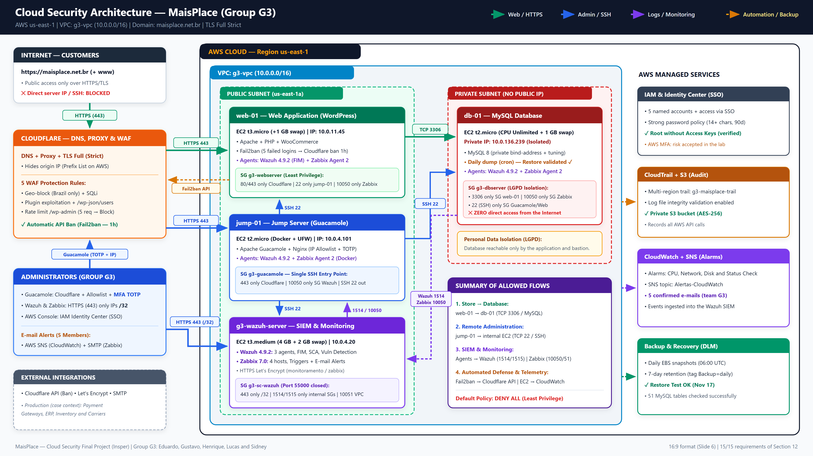
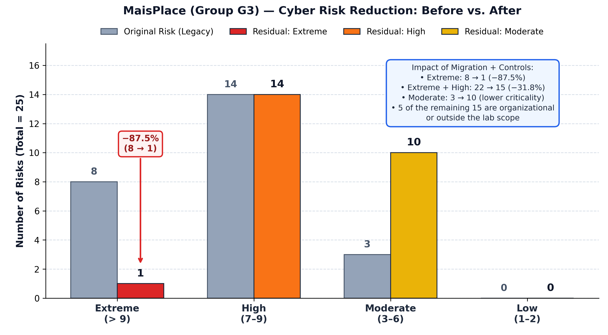

**English** | [Português](README.pt-BR.md)

# MaisPlace — Secure migration of an e-commerce store to AWS

Project for the **Cloud Cybersecurity** course (Insper, 2026-2). The group received the **MaisPlace** case study, a fictional WooCommerce store that suffered from downtime during campaigns, shared administrative accounts and changes made directly in production, and had to rebuild it on AWS with a security control for each high risk, evidence that the control works and a record of what is still open.

> Academic lab environment. MaisPlace is a fictional company and there is no real customer data. Account IDs, public IP addresses and credentials were masked or removed (for example, `<MONITORING-EIP>`).

The Markdown documentation is available in English (`*.md`) and Portuguese (`*.pt-BR.md`), and the final presentation has both versions. The lab reports (PDF and DOCX) and the risk matrix (PDF and XLSX) are in Portuguese only; the English summary of each one is in the README of its folder ([`labs/README.md`](labs/README.md) and [`final-delivery/README.md`](final-delivery/README.md)).



## Results

| Indicator | Legacy | With the controls on AWS |
| --- | --- | --- |
| Extreme risks (out of 25 assessed) | 8 | 1 |
| Extreme + high risks | 22 | 15 |
| Database | Poorly segmented network | Private subnet, no public IP, only port 3306 from the webserver |
| Remote administration | No standard, shared accounts and no MFA | SSH closed to the internet; jump server with TOTP and VPN |
| System vulnerabilities (Wazuh) | 403 critical and 1,562 high CVEs | Security packages and kernel updated before the final scan |
| External scan (OWASP ZAP Baseline) | None | 0 high, 7 medium, 10 low alerts |

The risk scores are the group's assessment (likelihood × impact, from 1 to 4), not a measurement of prevented attacks. The external scan is passive and unauthenticated, so it does not cover authenticated routes or the origin server.



## What was built

**Edge and application**
- Cloudflare as DNS, proxy and WAF, with 5 rules: geo-blocking, plugin exploitation, SQL injection, rate limiting on `/wp-admin` and blocking of user enumeration.
- Fail2ban integrated with the Cloudflare API: 5 invalid WordPress logins trigger a 1-hour block at the edge.
- TOTP MFA on the WordPress dashboard.

**Network**
- VPC with a public subnet (webserver, jump server, monitoring) and a private subnet (database).
- Security Groups that reference each other by role: the webserver only accepts 80/443 from the Cloudflare prefix list, and the database only accepts 3306 from the webserver.

**Administrative access**
- Apache Guacamole as the jump server, with mandatory TOTP and an IP allowlist.
- OpenVPN with one profile per member and only UDP port 1194 open.
- Individual IAM users and a 14-character password policy.

**Monitoring and audit**
- Wazuh (SIEM): vulnerability detection, file integrity monitoring (FIM) and security configuration assessment (SCA) on three agents.
- Zabbix: four hosts, custom triggers and tested e-mail alerting.
- CloudWatch with four alarms and SNS; CloudTrail in all regions with integrity validation.

**Continuity**
- Daily DLM snapshots with 7-day retention, MySQL dump and a verified restore.

## How the project evolved

| Stage | What was built | Folder |
| --- | --- | --- |
| Lab 1 | Webserver and database on separate instances (database in a private subnet), WordPress, Cloudflare with 5 WAF rules and Wazuh with vulnerability detection, FIM and a custom rule for `wp-config.php` | [lab-1-infra-waf-siem](labs/lab-1-infra-waf-siem/) |
| Lab 2 | Guacamole jump server with TOTP and allowlist, server SSH closed to the internet, Fail2ban calling the Cloudflare API and webserver restricted to the Cloudflare prefix list | [lab-2-jump-server-fail2ban](labs/lab-2-jump-server-fail2ban/) |
| Lab 3 | CloudWatch alarms (CPU, status check, network and disk writes) notifying an SNS topic; CPU, network and disk tested with real load | [lab-3-cloudwatch](labs/lab-3-cloudwatch/) |
| Lab 4 | Zabbix on the same instance as Wazuh, with HTTPS per subdomain, four hosts, seven custom triggers, e-mail alerting and a Zabbix × Wazuh comparison on the database incident | [lab-4-zabbix](labs/lab-4-zabbix/) |
| Final delivery | Matrix of 25 risks with CIS v8 controls, risk → evidence traceability, VPN, WordPress MFA, backups with a tested restore, external scan and a 12-slide presentation | [final-delivery](final-delivery/) |

There is also a class activity on access, privileges and resource monitoring, in [`labs/class-activity-resource-management/`](labs/class-activity-resource-management/). The summary of each lab is in [`labs/README.md`](labs/README.md).

## Real incident during the project

In the early hours of 2026-11-06 the database server (t2.micro, 1 GB of RAM, no swap and CPU credits exhausted) hung and the store went down, while the EC2 status check stayed "ok". Zabbix showed the effect and the Wazuh events led to the cause. The lesson became a project requirement: monitor the service and the application, not just the instance. The case is in the Lab 4 report and summarized in [`docs/incident-db01.md`](docs/incident-db01.md).

## Remaining risks

- One extreme risk: application and integration secrets, with no secrets vault or automatic rotation.
- AWS console without MFA and unencrypted EBS volumes, accepted as lab risks.
- No Auto Scaling or Multi-AZ.

Proposed next steps: secret rotation, infrastructure as code, RDS Multi-AZ, Auto Scaling for campaigns and a quarterly review of the matrix.

## Repository structure

Each document has the English version (`NAME.md`) and the Portuguese version (`NAME.pt-BR.md`) side by side. Evidence file and folder names (such as `evidencias_aws/` and `figuras/`) are in Portuguese.

```
.
├── docs/                              Supporting documentation
│   ├── architecture.md                Rationale for each component and hardening
│   ├── risk-traceability.md           Risk → requirement → control → evidence
│   └── incident-db01.md               Post-mortem of the database hang
├── final-delivery/                    Group's final delivery
│   ├── Apresentacao_Final_G3.*        Slides in Portuguese (PDF and PPTX)
│   ├── Final_Presentation_G3_EN.*     Slides in English (PDF and PPTX)
│   ├── Matriz_AmeacasRiscos_*         Risk matrix (PDF and XLSX, in Portuguese)
│   ├── evidencias_aws/                Screenshots of the AWS console and servers
│   ├── evidencias_novas/              Screenshots from the final week
│   ├── evidencias_slides/             Crops used in the slides
│   ├── figuras/                       Diagram, charts and icons (English versions in figuras/en/)
│   └── gerar_*.py, textos_en.py       Scripts that generate the slides and figures
├── labs/                              The four labs and the class activity
│   ├── lab-1-infra-waf-siem/
│   ├── lab-2-jump-server-fail2ban/
│   ├── lab-3-cloudwatch/
│   ├── lab-4-zabbix/                  Report (DOCX + scripts) and Task 1
│   └── class-activity-resource-management/
└── external-scan/                     OWASP ZAP: script, reports and raw output
```

Main deliverables:

| File | Content |
| --- | --- |
| [`final-delivery/Final_Presentation_G3_EN.pdf`](final-delivery/Final_Presentation_G3_EN.pdf) | Final presentation, 12 slides (Portuguese version: [`Apresentacao_Final_G3.pdf`](final-delivery/Apresentacao_Final_G3.pdf)) |
| [`final-delivery/Matriz_AmeacasRiscos_MaisPlaceGrupo3_v2.pdf`](final-delivery/Matriz_AmeacasRiscos_MaisPlaceGrupo3_v2.pdf) | Matrix with the 25 risks, CIS v8 controls and evidence (also as `.xlsx`; in Portuguese) |
| [`docs/architecture.md`](docs/architecture.md) | Rationale for each architecture component and for the hardening |
| [`docs/risk-traceability.md`](docs/risk-traceability.md) | Traceability risk → requirement → control → implementation → evidence |
| [`external-scan/report-2026-11-19.md`](external-scan/report-2026-11-19.md) | Method, result and limits of the external scan |
| [`final-delivery/README.md`](final-delivery/README.md) | Each piece of evidence and the control it proves |

## My contribution (Lucas)

The work was split among the five members. The parts below are the ones I did and that are recorded in the reports or in the history of the original repository:

- **Lab 3:** abnormal network usage alarm (`High-Network-Traffic-Alarm`, NetworkIn above 50 MB per minute), with EC2 detailed monitoring and a test using a batch download of about 1 GB, which moved the alarm to ALARM and produced the SNS e-mail.
- **Lab 4, evidence and tests:** monitoring of web-01 in Zabbix, the general dashboard, CPU and stopped-agent alert tests and the e-mail alert test (screenshots in `evidencias_lucas/`).
- **Lab 4, incident analysis:** comparison between Zabbix and Wazuh on the 2026-11-06 database hang, cross-checking the timestamps of both dashboards.
- **Lab 4, report:** Python scripts (`build.py`, `t1_section.py`, `t3_testes.py`) that assemble the DOCX report from the text and the screenshots.
- **Final delivery:** update of WordPress and of the security packages on web-01 and db-01, the final external scan on Nov 19, the scripts that generate the 12-slide presentation and the matrix figures, and the review of risk ID 4 in matrix v2.2.

## Technologies

AWS (EC2, VPC, Security Groups, IAM, CloudWatch, SNS, CloudTrail, DLM, S3) · Cloudflare (DNS, WAF, API) · WordPress and WooCommerce · MySQL 8 · Apache Guacamole · OpenVPN · Wazuh · Zabbix · Fail2ban · OWASP ZAP · Docker · Python

## Team

Group 3: Eduardo, Gustavo, Henrique, Lucas and Sidney.

## Note

Academic group work, published as a portfolio, with no license for reuse. Lab environment: the company is fictional and account identifiers, public IPs and credentials were masked.
