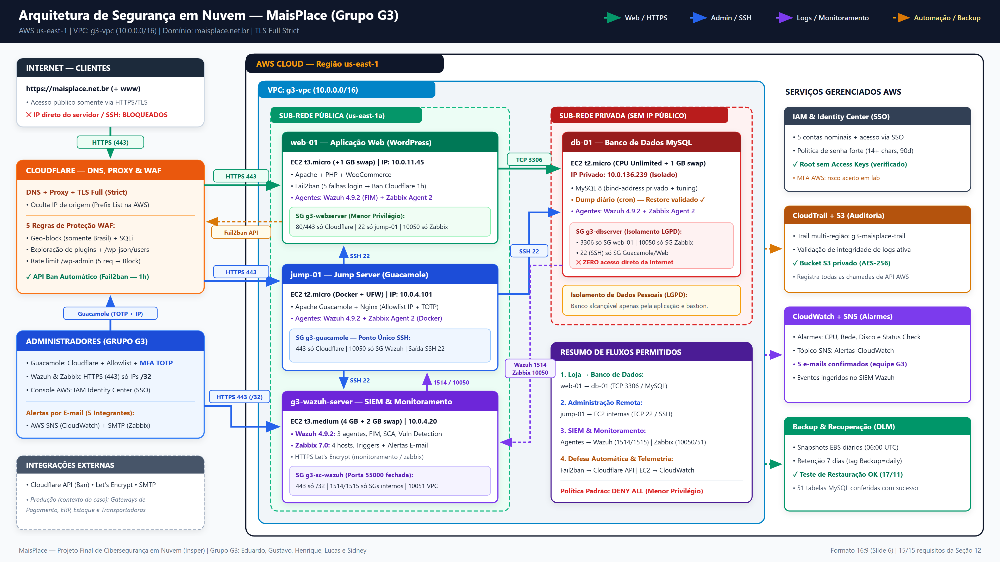
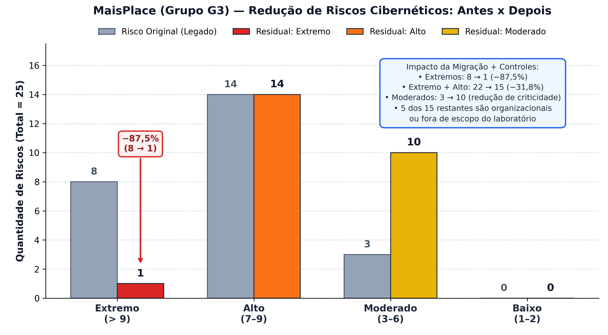

[English](README.md) | **Português**

# MaisPlace — Migração segura de um e-commerce para a AWS

Projeto da disciplina **Cibersegurança em Nuvem** (Insper, 2026-2). O grupo recebeu o estudo de caso da **MaisPlace**, uma loja WooCommerce fictícia que sofria com indisponibilidade em campanha, contas administrativas compartilhadas e mudanças feitas direto em produção, e teve de reconstruí-la na AWS com um controle de segurança para cada risco alto, a evidência de que o controle funciona e o registro do que continua em aberto.

> Ambiente de laboratório acadêmico. A MaisPlace é uma empresa fictícia e não há dados reais de clientes. IDs de conta, endereços IP públicos e credenciais foram mascarados ou removidos (por exemplo, `<EIP-MONITORAMENTO>`).

A documentação em Markdown existe em português (`*.pt-BR.md`) e em inglês (`*.md`), e a apresentação final tem as duas versões. Os relatórios dos roteiros (PDF e DOCX) e a matriz de riscos (PDF e XLSX) estão só em português.



## Resultado

| Indicador | Legado | Com os controles na AWS |
| --- | --- | --- |
| Riscos extremos (de 25 avaliados) | 8 | 1 |
| Riscos extremos + altos | 22 | 15 |
| Banco de dados | Rede pouco segmentada | Sub-rede privada, sem IP público, só a porta 3306 a partir do webserver |
| Administração remota | Sem padrão, com contas compartilhadas e sem MFA | SSH fechado para a internet; jump server com TOTP e VPN |
| Vulnerabilidades do sistema (Wazuh) | 403 CVEs críticas e 1.562 altas | Pacotes de segurança e kernel atualizados antes do scan final |
| Scan externo (OWASP ZAP Baseline) | Não havia | 0 alertas altos, 7 médios, 10 baixos |

As notas de risco são a avaliação do grupo (probabilidade × impacto, de 1 a 4), não a medição de ataques evitados. O scan externo é passivo e sem login, então não cobre rotas autenticadas nem o servidor de origem.



## O que foi construído

**Borda e aplicação**
- Cloudflare como DNS, proxy e WAF, com 5 regras: bloqueio geográfico, exploração de plugins, SQL injection, limite de requisições em `/wp-admin` e bloqueio da enumeração de usuários.
- Fail2ban integrado à API da Cloudflare: 5 logins inválidos no WordPress geram um bloqueio de 1 hora na borda.
- MFA por TOTP no painel do WordPress.

**Rede**
- VPC com sub-rede pública (webserver, jump server, monitoramento) e sub-rede privada (banco).
- Security Groups que se referenciam por função: o webserver só aceita 80/443 da lista de prefixos da Cloudflare, e o banco só aceita 3306 do webserver.

**Acesso administrativo**
- Apache Guacamole como jump server, com TOTP obrigatório e allowlist de IP.
- OpenVPN com um perfil por integrante e somente a porta UDP 1194 aberta.
- Usuários IAM individuais e política de senha de 14 caracteres.

**Monitoramento e auditoria**
- Wazuh (SIEM): detecção de vulnerabilidades, integridade de arquivos (FIM) e avaliação de configuração (SCA) em três agentes.
- Zabbix: quatro hosts, gatilhos próprios e alerta por e-mail testado.
- CloudWatch com quatro alarmes e SNS; CloudTrail em todas as regiões com validação de integridade.

**Continuidade**
- Snapshots diários por DLM com retenção de 7 dias, dump do MySQL e restauração conferida.

## Como o projeto evoluiu

| Etapa | O que foi construído | Pasta |
| --- | --- | --- |
| Roteiro 1 | Webserver e banco em instâncias separadas (banco em sub-rede privada), WordPress, Cloudflare com 5 regras de WAF e Wazuh com detecção de vulnerabilidades, FIM e regra própria para `wp-config.php` | [lab-1-infra-waf-siem](labs/lab-1-infra-waf-siem/) |
| Roteiro 2 | Jump server Guacamole com TOTP e allowlist, SSH dos servidores fechado para a internet, Fail2ban acionando a API da Cloudflare e webserver restrito à lista de prefixos da Cloudflare | [lab-2-jump-server-fail2ban](labs/lab-2-jump-server-fail2ban/) |
| Roteiro 3 | Alarmes do CloudWatch (CPU, status check, rede e escrita em disco) notificando um tópico SNS; CPU, rede e disco testados com carga real | [lab-3-cloudwatch](labs/lab-3-cloudwatch/) |
| Roteiro 4 | Zabbix na mesma instância do Wazuh, com HTTPS por subdomínio, quatro hosts, sete triggers próprias, alerta por e-mail e comparação Zabbix × Wazuh no incidente do banco | [lab-4-zabbix](labs/lab-4-zabbix/) |
| Entrega final | Matriz de 25 riscos com controles CIS v8, rastreabilidade risco → evidência, VPN, MFA no WordPress, backups com restauração testada, scan externo e apresentação de 12 slides | [final-delivery](final-delivery/) |

Também há uma atividade de aula sobre acessos, privilégios e monitoramento dos recursos, em [`labs/class-activity-resource-management/`](labs/class-activity-resource-management/). O resumo de cada roteiro está em [`labs/README.pt-BR.md`](labs/README.pt-BR.md).

## Incidente real durante o projeto

Na madrugada de 06/11/2026 o servidor de banco (t2.micro, 1 GB de RAM, sem swap e com os créditos de CPU zerados) travou e a loja saiu do ar, enquanto o status check da EC2 continuava "ok". O Zabbix mostrou o efeito e os eventos do Wazuh levaram à causa. A lição virou requisito do projeto: monitorar o serviço e a aplicação, e não só a instância. O caso está no relatório do Roteiro 4 e resumido em [`docs/incident-db01.pt-BR.md`](docs/incident-db01.pt-BR.md).

## Riscos que permanecem

- Um risco extremo: segredos de aplicação e integrações, sem cofre de segredos nem rotação automática.
- Console da AWS sem MFA e volumes EBS sem criptografia, aceitos como risco do laboratório.
- Sem Auto Scaling nem Multi-AZ.

Próximos passos propostos: rotação de segredos, infraestrutura como código, RDS Multi-AZ, Auto Scaling para campanhas e revisão trimestral da matriz.

## Estrutura do repositório

Cada documento tem a versão em inglês (`NOME.md`) e a versão em português (`NOME.pt-BR.md`) lado a lado.

```
.
├── docs/                              Documentação de apoio
│   ├── architecture.pt-BR.md          Justificativa de cada componente e hardening
│   ├── risk-traceability.pt-BR.md     Risco → requisito → controle → evidência
│   └── incident-db01.pt-BR.md         Post-mortem do travamento do banco
├── final-delivery/                    Entrega final do grupo
│   ├── Apresentacao_Final_G3.*        Slides em português (PDF e PPTX)
│   ├── Final_Presentation_G3_EN.*     Slides em inglês (PDF e PPTX)
│   ├── Matriz_AmeacasRiscos_*         Matriz de riscos (PDF e XLSX, em português)
│   ├── evidencias_aws/                Prints do console AWS e dos servidores
│   ├── evidencias_novas/              Prints da semana final
│   ├── evidencias_slides/             Recortes usados nos slides
│   ├── figuras/                       Diagrama, gráficos e ícones (versão em inglês em figuras/en/)
│   └── gerar_*.py, textos_en.py       Scripts que geram slides e figuras
├── labs/                              Os quatro roteiros e a atividade de aula
│   ├── lab-1-infra-waf-siem/
│   ├── lab-2-jump-server-fail2ban/
│   ├── lab-3-cloudwatch/
│   ├── lab-4-zabbix/                  Relatório (DOCX + scripts) e Tarefa 1
│   └── class-activity-resource-management/
└── external-scan/                     OWASP ZAP: script, relatórios e saídas brutas
```

Entregáveis principais:

| Arquivo | Conteúdo |
| --- | --- |
| [`final-delivery/Apresentacao_Final_G3.pdf`](final-delivery/Apresentacao_Final_G3.pdf) | Apresentação final, 12 slides (versão em inglês: [`Final_Presentation_G3_EN.pdf`](final-delivery/Final_Presentation_G3_EN.pdf)) |
| [`final-delivery/Matriz_AmeacasRiscos_MaisPlaceGrupo3_v2.pdf`](final-delivery/Matriz_AmeacasRiscos_MaisPlaceGrupo3_v2.pdf) | Matriz com os 25 riscos, controles CIS v8 e evidências (também em `.xlsx`) |
| [`docs/architecture.pt-BR.md`](docs/architecture.pt-BR.md) | Justificativa de cada componente da arquitetura e do hardening |
| [`docs/risk-traceability.pt-BR.md`](docs/risk-traceability.pt-BR.md) | Rastreabilidade risco → requisito → controle → implementação → evidência |
| [`external-scan/report-2026-11-19.pt-BR.md`](external-scan/report-2026-11-19.pt-BR.md) | Método, resultado e limites do scan externo |
| [`final-delivery/README.pt-BR.md`](final-delivery/README.pt-BR.md) | Cada evidência e o controle que ela comprova |

## Minha contribuição (Lucas)

O trabalho foi dividido entre os cinco integrantes. As partes abaixo são as que fiz e que estão registradas nos relatórios ou no histórico do repositório original:

- **Roteiro 3:** alarme de consumo anormal de rede (`High-Network-Traffic-Alarm`, NetworkIn acima de 50 MB por minuto), com monitoramento detalhado da EC2 e teste por download em lote de cerca de 1 GB, que levou o alarme a ALARM e gerou o e-mail do SNS.
- **Roteiro 4, evidências e testes:** monitoramento do web-01 no Zabbix, dashboard geral, testes de alerta de CPU e de agente parado e teste do alerta por e-mail (prints em `evidencias_lucas/`).
- **Roteiro 4, análise do incidente:** comparação entre Zabbix e Wazuh no travamento do banco de 06/11/2026, cruzando os horários dos dois painéis.
- **Roteiro 4, relatório:** scripts em Python (`build.py`, `t1_section.py`, `t3_testes.py`) que montam o relatório DOCX a partir do texto e dos prints.
- **Entrega final:** atualização do WordPress e dos pacotes de segurança no web-01 e no db-01, scan externo final de 19/11, scripts que geram a apresentação de 12 slides e as figuras da matriz, e revisão do risco ID 4 na matriz v2.2.

## Tecnologias

AWS (EC2, VPC, Security Groups, IAM, CloudWatch, SNS, CloudTrail, DLM, S3) · Cloudflare (DNS, WAF, API) · WordPress e WooCommerce · MySQL 8 · Apache Guacamole · OpenVPN · Wazuh · Zabbix · Fail2ban · OWASP ZAP · Docker · Python

## Equipe

Grupo 3: Eduardo, Gustavo, Henrique, Lucas e Sidney.

## Nota

Trabalho acadêmico feito em grupo, publicado como portfólio, sem licença de reutilização. Ambiente de laboratório: a empresa é fictícia e identificadores de conta, IPs públicos e credenciais foram mascarados.
