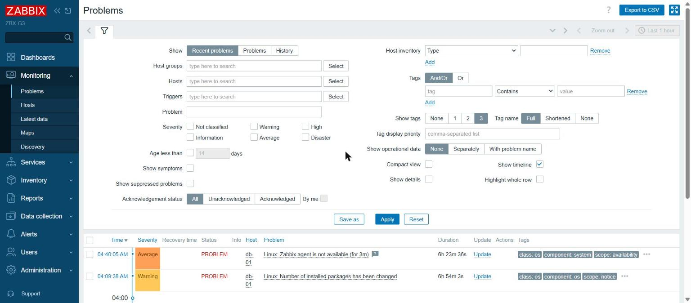
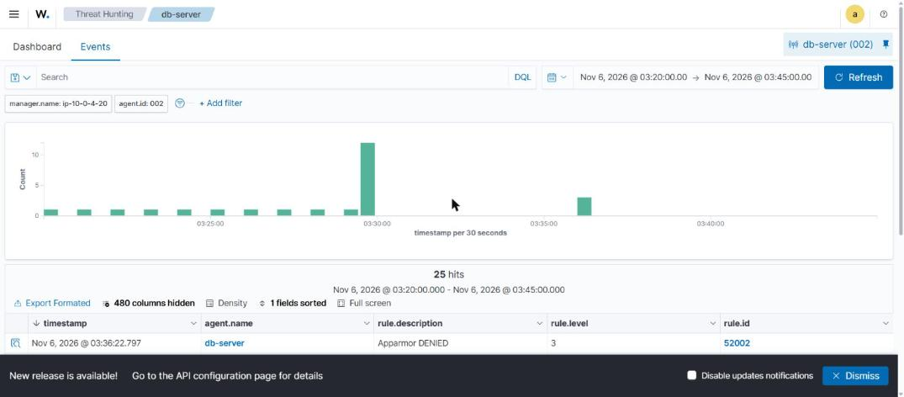
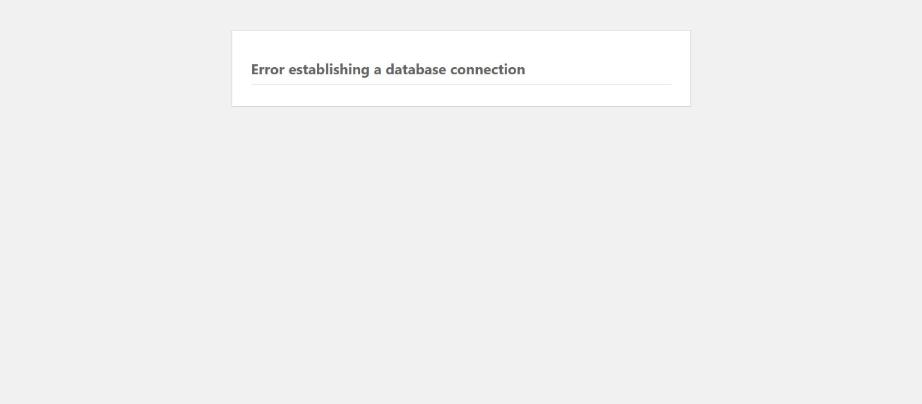

**English** | [Português](incident-db01.pt-BR.md)

# Incident: database (db-01) hang on 2026-11-06

Short post-mortem, built from the Lab 4 report (sections 2, 3.2 and 4.3; the report is in Portuguese). Times are in local time (UTC-3), as they appear in the Zabbix and Wazuh interfaces.

## Summary

In the early hours of 2026-11-06, MySQL on `db-01` stopped because the server ran out of memory. The web server stayed up and Apache responded, but the store returned HTTP 500 with "Error establishing a database connection". Zabbix recorded the service going down at 03:36 and Wazuh recorded, in the same second, the system running out of memory. Nobody was notified: at 11:20 the site was still showing the error, about 8 hours later.

| Item | Value |
| --- | --- |
| Server | `db-01` (MySQL 8, t2.micro, 1 vCPU, 1 GB of RAM, no swap, private subnet, `10.0.136.239`) |
| Impact | Store down (database connection error) |
| MySQL downtime | Nov 6, 03:36:21 to Nov 7, 12:23:10 (1 day, 8 h and 46 min) |
| Detection | Zabbix (effect) and Wazuh (probable cause), no notification delivered |
| Recurrence | Nov 9, 04:46:54 to 15:02:35; on Nov 10 the system hung again until a reboot |

## Timeline

| Time | Source | Event |
| --- | --- | --- |
| Nov 6, 00:08 to 00:21 | Zabbix | First short occurrence of "MySQL: Service is down", with recovery |
| 03:29:46 to 03:29:55 | Wazuh | Burst of package installation events (`dpkg`, rules 2902 and 2904) |
| 03:36:21 | Zabbix | "MySQL: Service is down" (High) and high load average |
| 03:36:22 | Wazuh | Rule 5108, level 12: "System running out of memory", plus AppArmor denials |
| 04:05 to 04:15 | Wazuh | New package installations, interleaved with out-of-memory events (04:10:55 and 04:11:41) |
| 04:09 | Zabbix | "Number of installed packages has been changed" |
| 04:29 to 04:35 | Wazuh | Three more out-of-memory alerts (rule 5108) |
| 04:29 to 04:30 | Zabbix | Last values collected: CPU at 100%, 92.65% of it system time |
| 04:40 | Zabbix | "Zabbix agent is not available (for 3m)" |
| 05:01:32 | Wazuh | Rule 504: "Wazuh agent disconnected" |
| 11:20 | Browser | `https://maisplace.net.br` returns HTTP 500, no database connection |
| Nov 7, 12:23 | Zabbix | MySQL responds again |
| Nov 10, around 13:10 | Operations | After further agent drops and a failed instance status check, a reboot restores the database and the site |

## How it was detected

The two tools saw the same incident from different angles:

- **Zabbix** showed the effect: MySQL service down, high load, a change in the package count and, finally, loss of the agent. It did not show the cause, because there was no low-memory trigger on `db-01`.
- **Wazuh** showed the probable cause: the system running out of memory one second after the Zabbix alert, plus package installation events happening with the system already out of memory.

After the agent was lost, the Zabbix dashboard kept the last values (CPU 100%) without updating them. Anyone looking only at the dashboard could take a stale value for a current one. The agent availability indicator is what shows that the data stopped.

*Zabbix, Monitoring > Problems: db-01 alerts on 2026-11-06.*

*Wazuh, db-server events from 03:20 to 03:45: `dpkg` burst at 03:29 and out of memory at 03:36:22.*

*The store at 11:20 on the same day: WordPress with no database connection.*

## Cause

Lack of memory on `db-01`. The instance had 1 GB of RAM and no swap; on Nov 6 the instance terminal showed only 123 MB available. The package installation during the night coincided with the memory alerts. Which process consumed the memory was not investigated in the server logs.

Two factors made the failure last for hours:

- **No alert reached anyone.** At that time Zabbix had no working notification action (the first e-mail attempt failed with "Login denied") and Wazuh e-mail was failing because `wazuh-maild` does not authenticate to Gmail without a local relay.
- **Instance-centric monitoring.** The instance was still "up" and the web server responded; only a MySQL or application check showed the problem.

## Fix

| When | What was done |
| --- | --- |
| 2026-11-10 | Reboot of `db-01`; `mysql.ping` goes back to 1 |
| Lab 4, Task 3 | Low-memory trigger on `db-01` (less than 150 MB for 5 min) and disk above 80% |
| 2026-11-10 | Zabbix e-mail fixed and tested with a real alert and recovery |
| 2026-11-17 | Stabilization of `db-01`: CPU in `unlimited` mode, 1 GB swap and MySQL tuning |

## Lessons

1. Monitor the service and the application, not just the instance. "Up" does not mean "working".
2. An alert nobody receives is not an alert. The notification channel must be tested end to end.
3. Zabbix and Wazuh complement each other: one points to when and what, the other helps explain why. The root cause came from cross-checking the timestamps.
4. Small instances without swap have no headroom. Available memory and swap go on the list of priority indicators.
5. A frozen value on the dashboard is misleading. Agent availability should be visible next to the metrics.

Full source: Lab 4 report (in Portuguese), [`labs/lab-4-zabbix/report/`](../labs/lab-4-zabbix/report/).
