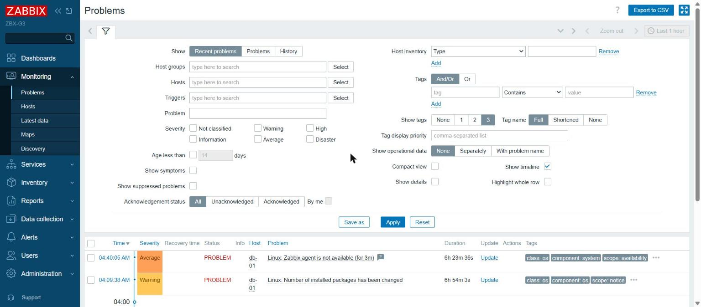
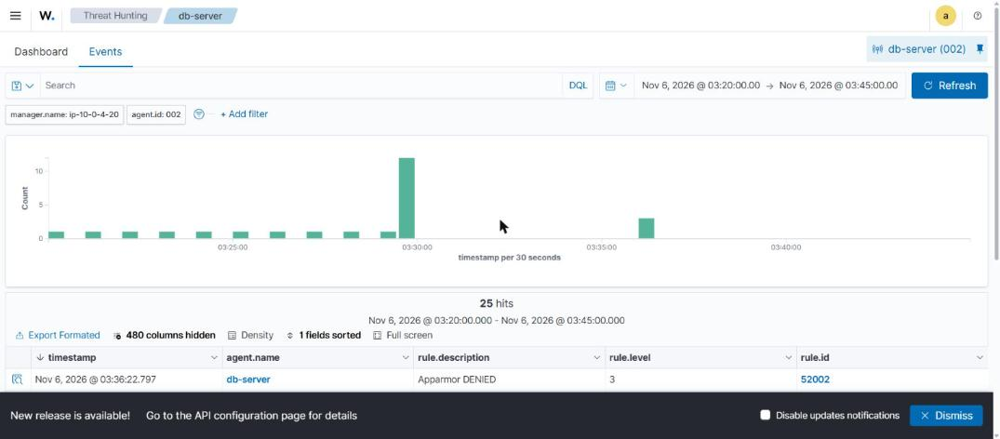
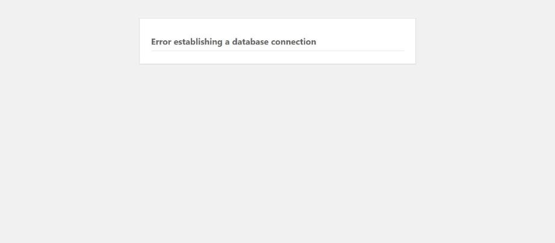

[English](incident-db01.md) | **Português**

# Incidente: travamento do banco de dados (db-01) em 06/11/2026

Post-mortem curto, montado a partir do relatório do Roteiro 4 (seções 2, 3.2 e 4.3). Horários no fuso local (UTC-3), como aparecem nas interfaces do Zabbix e do Wazuh.

## Resumo

Na madrugada de 06/11/2026 o MySQL do `db-01` parou por falta de memória. O servidor web continuou ligado e o Apache respondia, mas a loja devolvia HTTP 500 com "Error establishing a database connection". O Zabbix registrou a queda do serviço às 03:36 e o Wazuh registrou, no mesmo segundo, a falta de memória do sistema. Ninguém foi avisado: às 11:20 o site ainda mostrava o erro, cerca de 8 horas depois.

| Item | Valor |
| --- | --- |
| Servidor | `db-01` (MySQL 8, t2.micro, 1 vCPU, 1 GB de RAM, sem swap, sub-rede privada, `10.0.136.239`) |
| Impacto | Loja fora do ar (erro de conexão com o banco) |
| Duração do MySQL fora | 06/11, 03:36:21 a 07/11, 12:23:10 (1 dia, 8 h e 46 min) |
| Detecção | Zabbix (efeito) e Wazuh (causa provável), sem notificação entregue |
| Recorrência | 09/11, 04:46:54 a 15:02:35; em 10/11 o sistema travou de novo até um reboot |

## Linha do tempo

| Horário | Fonte | Evento |
| --- | --- | --- |
| 06/11, 00:08 a 00:21 | Zabbix | Primeira ocorrência curta de "MySQL: Service is down", com recuperação |
| 03:29:46 a 03:29:55 | Wazuh | Rajada de eventos de instalação de pacotes (`dpkg`, regras 2902 e 2904) |
| 03:36:21 | Zabbix | "MySQL: Service is down" (High) e carga média alta |
| 03:36:22 | Wazuh | Regra 5108, nível 12: "System running out of memory", mais negações do AppArmor |
| 04:05 a 04:15 | Wazuh | Novas instalações de pacotes, intercaladas com falta de memória (04:10:55 e 04:11:41) |
| 04:09 | Zabbix | "Number of installed packages has been changed" |
| 04:29 a 04:35 | Wazuh | Mais três alertas de falta de memória (regra 5108) |
| 04:29 a 04:30 | Zabbix | Últimos valores coletados: CPU em 100%, sendo 92,65% de tempo de sistema |
| 04:40 | Zabbix | "Zabbix agent is not available (for 3m)" |
| 05:01:32 | Wazuh | Regra 504: "Wazuh agent disconnected" |
| 11:20 | Navegador | `https://maisplace.net.br` responde HTTP 500, sem conexão com o banco |
| 07/11, 12:23 | Zabbix | MySQL volta a responder |
| 10/11, cerca de 13:10 | Operação | Depois de novas quedas do agente e do status check da instância reprovado, um reboot restabelece banco e site |

## Como foi detectado

As duas ferramentas viram o mesmo incidente por ângulos diferentes:

- **Zabbix** mostrou o efeito: serviço MySQL fora, carga alta, mudança na contagem de pacotes e, por fim, perda do agente. Não mostrou a causa, porque não havia trigger de memória baixa no `db-01`.
- **Wazuh** mostrou a causa provável: falta de memória no sistema um segundo depois do alerta do Zabbix, além dos eventos de instalação de pacotes ocorrendo com o sistema já sem memória.

Depois da perda do agente, o painel do Zabbix manteve os últimos valores (CPU 100%) sem atualização. Quem olhasse só o painel poderia tomar um valor velho como atual. O indicador de disponibilidade do agente é o que mostra que os dados pararam.

*Zabbix, Monitoring > Problems: alertas do db-01 em 06/11/2026.*

*Wazuh, eventos do db-server de 03:20 a 03:45: rajada de `dpkg` às 03:29 e falta de memória às 03:36:22.*

*A loja às 11:20 do mesmo dia: WordPress sem conexão com o banco.*

## Causa

Falta de memória no `db-01`. A instância tinha 1 GB de RAM e nenhuma swap; em 06/11 o terminal da instância mostrava só 123 MB disponíveis. A instalação de pacotes durante a madrugada coincidiu com os alertas de memória. Qual processo consumiu a memória não foi investigado nos logs do servidor.

Dois fatores fizeram a falha durar horas:

- **Nenhum alerta chegou a alguém.** Naquele momento o Zabbix não tinha ação de notificação funcionando (a primeira tentativa de e-mail falhou com "Login denied") e o e-mail do Wazuh falhava porque o `wazuh-maild` não autentica no Gmail sem um relay local.
- **Monitoramento centrado na instância.** A instância continuava "ligada" e o servidor web respondia; só uma checagem do MySQL ou da aplicação mostrava o problema.

## Correção

| Quando | O que foi feito |
| --- | --- |
| 10/11/2026 | Reboot do `db-01`; `mysql.ping` volta a 1 |
| Roteiro 4, Tarefa 3 | Trigger de memória baixa no `db-01` (menos de 150 MB por 5 min) e de disco acima de 80% |
| 10/11/2026 | E-mail do Zabbix corrigido e testado com alerta e recuperação reais |
| 17/11/2026 | Estabilização do `db-01`: CPU em modo `unlimited`, swap de 1 GB e ajuste do MySQL |

## Lições

1. Monitorar o serviço e a aplicação, não só a instância. "Ligado" não quer dizer "funcionando".
2. Um alerta que ninguém recebe não é um alerta. O canal de notificação precisa ser testado de ponta a ponta.
3. Zabbix e Wazuh se completam: um aponta quando e o quê, o outro ajuda a explicar por quê. A causa raiz saiu do cruzamento dos horários.
4. Instâncias pequenas sem swap não têm margem. Memória disponível e swap entram na lista de indicadores prioritários.
5. Valor congelado no painel engana. A disponibilidade do agente deve ficar visível ao lado das métricas.

Fonte completa: relatório do Roteiro 4, [`labs/lab-4-zabbix/report/`](../labs/lab-4-zabbix/report/).
